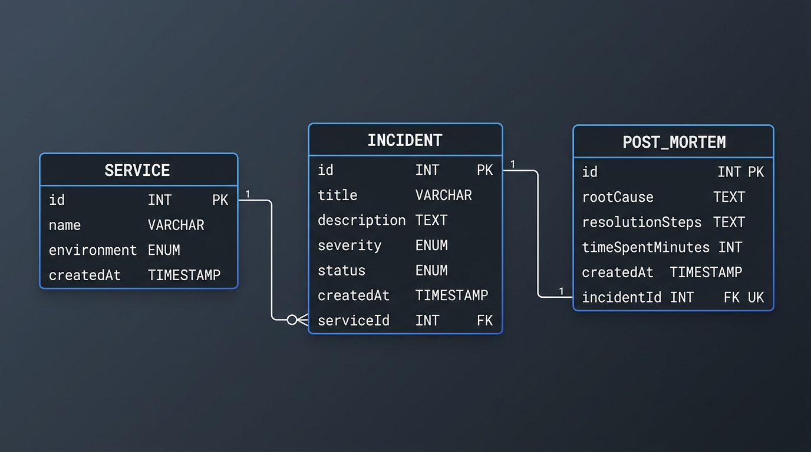

# DevLog: Time-Budgeted Incident & Post-Mortem Logger
## Academic Project Report & Technical Specification

---

### Project & Candidate Information
- **Project Title**: DevLog — Time-Budgeted Incident & Post-Mortem Logger
- **Candidate Name**: Afrah Ghazi
- **Degree / Level**: Bachelor of Technology (Second-Year Computer Science & Engineering)
- **Academic Year**: 2026–2027
- **Evaluation Committee / Faculty Guide**: Department of Computer Science & Engineering
- **Domain**: Full-Stack Web Development, Distributed Systems Operations, & Advanced Database Management Systems (DBMS)
- **Version Control Repository**: [https://github.com/afrahghazi14-web/Devlog.git](https://github.com/afrahghazi14-web/Devlog.git)

---

## 1. Project Objectives & Problem Statement

### 1.1 Problem Statement
Modern software engineering teams operating distributed microservice architectures face frequent operational disruptions ranging from transient network timeouts to severe connection pool exhaustion. Resolving production outages under pressure typically introduces two systemic operational inefficiencies:
1. **Unmeasured Resolution Investment (Mean Time to Resolution - MTTR)**: Engineering organizations lack granular visibility into how many developer-hours are expended resolving recurring failures across individual services.
2. **Lost Institutional Knowledge**: Remediation steps and root cause analyses are frequently discussed in ephemeral communication channels (e.g., Slack or Zoom) and lost once an incident is closed, leading to repeated diagnosis of identical defects.

### 1.2 Core Project Objectives
DevLog was engineered to eliminate these operational blindspots through the following objectives:
- **Centralized Service & Incident Ledger**: Provide an operational dashboard to register services and log incidents with distinct severity levels (`LOW`, `MEDIUM`, `HIGH`, `CRITICAL`) and environments (`PRODUCTION`, `STAGING`, `QA`).
- **Atomic Incident Resolution & Post-Mortem Capture**: Require resolution time tracking (in minutes), root cause analysis, and remediation steps recorded simultaneously with status resolution in an ACID-compliant transaction.
- **Concurrency & Race Condition Elimination**: Prevent dual-resolve race conditions during concurrent on-call operations, returning graceful HTTP 409 Conflict responses instead of server crashes.
- **Empirical Database Performance Engineering**: Optimize operational query paths via custom partial B-Tree indexing, achieving over 30x query acceleration while reducing index disk footprint by over 90%.
- **Advanced SQL Analytics**: Formulate multi-table aggregations and service ranking via Common Table Expressions (CTEs) and SQL window functions (`RANK() OVER`).
- **Reactive, Accessible User Interface**: Build a responsive dark-mode single-page application adhering to strict modal accessibility standards and instant client-side cache invalidation.

---

## 2. Curriculum & Subject Competency Mapping

DevLog was developed to demonstrate practical mastery across three distinct computer science curriculum subjects:

| Curriculum Subject | Academic Competency / Module | Implementation in DevLog | Code Reference |
| :--- | :--- | :--- | :--- |
| **Backend Web Development** | **RESTful API Design & HTTP Semantics** | Endpoints with strict HTTP methods and status codes (`200 OK`, `201 Created`, `400 Bad Request`, `404 Not Found`, `409 Conflict`). | [incident.controller.js](backend/src/controllers/incident.controller.js#L5-L39) |
| **Backend Web Development** | **Layered Architectural Separation** | Strict 4-tier design: Routes $\rightarrow$ Controllers $\rightarrow$ Services $\rightarrow$ Repositories. | [backend/src/](backend/src/) |
| **Backend Web Development** | **Express Middleware & Pipeline** | Central async handler wrapper, rate limiting (300 req/15m), Helmet security headers, 100kb payload clamping. | [app.js](backend/src/app.js#L14-L44) |
| **Backend Web Development** | **Input Validation & Domain Invariants** | Rigorous domain verification for string lengths, enums, positive numbers, and existence checks. | [incident.service.js](backend/src/services/incident.service.js#L72-L117) |
| **Full-Stack Web Development** | **Single-Page Application Architecture** | React 19 with Vite, nested layout routes, persistent top navigation, and error boundary isolation. | [AppLayout.jsx](frontend/src/layouts/AppLayout.jsx#L5-L65) |
| **Full-Stack Web Development** | **Asynchronous Server State Management** | TanStack Query custom hooks, parameter-based query keys, optimistic pagination, and targeted query invalidation. | [useIncidents.js](frontend/src/hooks/useIncidents.js#L6-L21) |
| **Full-Stack Web Development** | **Accessible Modal Interactions** | Focus management moving focus into dialog on open, restoring focus on close, Escape key and backdrop dismissal. | [Modal.jsx](frontend/src/components/Modal.jsx#L19-L56) |
| **Full-Stack Web Development** | **Client-Side Form Validation** | React Hook Form managing modal forms, validation constraints, and immediate error rendering under inputs. | [AddIncidentModal.jsx](frontend/src/components/AddIncidentModal.jsx#L10-L165) |
| **Advanced DBMS** | **Relational Modeling & Normalization** | Third Normal Form (3NF) PostgreSQL schema with enums, composite unique constraints, and foreign key cascades. | [schema.prisma](backend/prisma/schema.prisma#L9-L60) |
| **Advanced DBMS** | **Partial B-Tree Index Optimization** | Custom partial index on open incidents (`WHERE status = 'OPEN'`) reducing query time by 35x with empirical EXPLAIN ANALYZE evidence. | [migration.sql](backend/prisma/migrations/20261024054943_add_partial_open_incident_index/migration.sql#L1-L3) |
| **Advanced DBMS** | **CTEs & Window Functions** | Service downtime ranking query using `WITH service_metrics AS (...)` and `RANK() OVER (ORDER BY "totalMinutesSpent" DESC)`. | [stats.repository.js](backend/src/repositories/stats.repository.js#L43-L78) |
| **Advanced DBMS** | **ACID Transactions & Concurrency Control** | Multi-Version Concurrency Control (MVCC) with atomic conditional row updates (`WHERE id = :id AND status = 'OPEN'`) preventing race conditions. | [incident.repository.js](backend/src/repositories/incident.repository.js#L68-L82) |

---

## 3. Technology Stack & Architectural Rationale

| Layer / Role | Selected Technology | Alternatives Evaluated | Engineering Rationale for Selection |
| :--- | :--- | :--- | :--- |
| **Runtime** | **Node.js (v20+ LTS)** | Deno, Bun, Python | High event-loop throughput for I/O-bound web services; mature enterprise ecosystem; native `node:test` runner. |
| **Backend Framework** | **Express.js (v4.21)** | Fastify, NestJS | Lightweight, unopinionated middleware chain; transparent routing pipeline ideal for demonstrating layered architecture. |
| **Relational Database** | **PostgreSQL (v16)** | MongoDB, MySQL | Robust ACID compliance; native support for partial B-Tree indexing; advanced window functions and CTEs; proven MVCC isolation. |
| **ORM & Driver** | **Prisma 7 + `@prisma/adapter-pg`** | TypeORM, Sequelize, Knex | Declarative schema migrations; connection pooling; type-safe relation joins (`include`) eliminating N+1 query overhead. |
| **Frontend Framework** | **React 19 + Vite** | Create React App, Next.js | Blazing-fast Hot Module Replacement (HMR); single-page architecture perfectly suited for real-time operations dashboards. |
| **Server-State Manager** | **TanStack Query (v5)** | Redux, Context API | Built-in declarative caching, automatic background polling (30s), refetching on window focus, and dynamic query invalidation. |
| **Form Management** | **React Hook Form** | Formik, Manual `useState` | Uncontrolled input architecture drastically reduces component re-renders; concise declarative validation rules. |
| **Design System** | **Tailwind CSS (v4)** | Bootstrap, CSS Modules | Zero-runtime CSS generation; fine-grained utility tokens; sleek dark-mode developer aesthetics without bulky stylesheet overhead. |

---

## 4. System Architecture & Layered Design

DevLog adheres to a strict **4-layer architectural separation of concerns**, completely isolating database logic, business rules, HTTP handling, and network routing:

```
[ HTTP Client (Browser / Fetch) ]
               │
               ▼
   [ 1. Routes Layer ]  (/api/v1/*.routes.js)
               │ Maps HTTP method + URL to controller
               ▼
[ 2. Controllers Layer ] (*.controller.js)
               │ Extracts request body/params, sets status codes, formats JSON
               ▼
  [ 3. Services Layer ]  (*.service.js)
               │ Business validation, transaction orchestration, domain rules
               ▼
[ 4. Repositories Layer ] (*.repository.js)
               │ The ONLY layer that imports Prisma and interacts with PostgreSQL
               ▼
   [ PostgreSQL Database ] (Devlog)
```

### Architectural Layer Responsibilities:
1. **Routes Layer** ([backend/src/routes/](backend/src/routes/)): Maps HTTP verbs and URI patterns to controller functions. Attaches rate-limiting and route-level middlewares.
2. **Controllers Layer** ([backend/src/controllers/](backend/src/controllers/)): Extracts payload parameters (`req.body`, `req.params`, `req.query`), invokes the service layer, and writes standardized JSON envelopes with correct HTTP status codes (`200 OK`, `201 Created`, `400 Bad Request`, `404 Not Found`, `409 Conflict`). Contains zero database queries.
3. **Services Layer** ([backend/src/services/](backend/src/services/)): Validates business domain invariants (e.g., verifying referenced services exist before logging incidents; validating string lengths and enum memberships). Services contain zero references to Express `req` or `res`.
4. **Repositories Layer** ([backend/src/repositories/](backend/src/repositories/)): Houses all database interactions, Prisma queries, and raw SQL. Isolates database drivers from upper layers.

---

## 5. Database Design & Relational Modeling

### 5.1 Entity-Relationship Diagram (ERD)



```
┌─────────────────────────────────┐
│             SERVICE             │
├─────────────────────────────────┤
│ id: INT (PK, Auto-Increment)    │
│ name: VARCHAR                   │
│ environment: ENUM (PROD/STG/QA) │
│ createdAt: TIMESTAMP            │
└───────────────┬─────────────────┘
                │ 1
                │
                │ N
┌───────────────▼─────────────────┐       1       ┌─────────────────────────────────┐
│            INCIDENT             ├───────────────►           POST_MORTEM           │
├─────────────────────────────────┤               ├─────────────────────────────────┤
│ id: INT (PK, Auto-Increment)    │               │ id: INT (PK, Auto-Increment)    │
│ title: VARCHAR                  │               │ rootCause: TEXT                 │
│ description: TEXT               │               │ resolutionSteps: TEXT           │
│ severity: ENUM (LOW..CRITICAL)  │               │ timeSpentMinutes: INT           │
│ status: ENUM (OPEN | RESOLVED)  │               │ createdAt: TIMESTAMP            │
│ createdAt: TIMESTAMP            │               │ incidentId: INT (FK, UNIQUE)    │
│ serviceId: INT (FK)             │               └─────────────────────────────────┘
└─────────────────────────────────┘
```

### 5.2 Third Normal Form (3NF) Normalization Proof
1. **First Normal Form (1NF)**:
   - Every relation possesses a distinct primary key (`id SERIAL`).
   - All attribute values are strictly atomic (no repeating groups, arrays, or compound delimited strings).
2. **Second Normal Form (2NF)**:
   - Relations are in 1NF.
   - All non-key attributes are fully functionally dependent on the entire primary key. In `Service`, `name` and `environment` depend directly on `id`. In `Incident`, `title`, `description`, `severity`, and `status` depend directly on `id`. There are zero partial dependencies.
3. **Third Normal Form (3NF)**:
   - Relations are in 2NF.
   - **Zero Transitive Dependencies**: Non-key attributes do not depend on other non-key attributes. For example, `Incident` stores only the `serviceId` foreign key; it never redundantly duplicates `serviceName` or `serviceEnvironment`. Service data is retrieved dynamically via relational joins (`include: { service: true }`).

### 5.3 Constraints & Referential Integrity
- **Composite Unique Constraint**: `@@unique([name, environment])` prevents registering two services with identical names in the same environment while permitting "User Auth" in `STAGING` and "User Auth" in `PRODUCTION`.
- **Foreign Key Actions**:
  - `Incident.serviceId` references `Service.id` with `ON DELETE RESTRICT ON UPDATE CASCADE`. This protects historical operational data by rejecting service deletions if incidents are attached.
  - `PostMortem.incidentId` references `Incident.id` with `ON DELETE CASCADE ON UPDATE CASCADE` and an explicit `UNIQUE` constraint, enforcing a strict 1-to-0..1 relationship.

---

## 6. Concurrency Control & ACID Transactions

### 6.1 The Dual-Resolve Race Condition
In collaborative operations environments, two on-call engineers (Alice and Bob) may view the same open incident and click "Resolve & Post-Mortem" simultaneously.

### 6.2 The Naive Flaw (Read-Then-Write Check)
A naive implementation relies on application-level read checks:
```javascript
// NAIVE FLAW: Prone to TOCTOU (Time-of-Check to Time-of-Use)
const incident = await prisma.incident.findUnique({ where: { id } });
if (incident.status === 'RESOLVED') {
  return res.status(409).json({ error: 'Already resolved' });
}
await prisma.incident.update({ where: { id }, data: { status: 'RESOLVED' } });
await prisma.postMortem.create({ data: { incidentId: id, ...postMortemData } });
```

**Why this fails in practice:**
1. Alice and Bob concurrently read the incident row; both observe `status: "OPEN"`.
2. Alice updates the incident status to `RESOLVED` and inserts the `PostMortem` record successfully.
3. Bob's thread attempts to insert a second `PostMortem` record referencing the same `incidentId`.
4. Because `PostMortem.incidentId` enforces an explicit `UNIQUE` constraint in the database, the database rejects Bob's insert with a unique constraint violation error (Prisma error code `P2002`).
5. **The Real Flaw**: The database is protected from corruption by the unique constraint, but Bob's request crashes with an unhandled internal server error (**HTTP 500**), presenting an alarming error screen instead of an informative, graceful message.

### 6.3 The DevLog Atomic Solution
DevLog wraps the resolve workflow in a single database transaction (`prisma.$transaction`) using an **atomic conditional row update**:

```javascript
// backend/src/repositories/incident.repository.js
export async function executeResolveTransaction(incidentId, { rootCause, resolutionSteps, timeSpentMinutes }) {
  return prisma.$transaction(async (tx) => {
    // 1. Verify existence
    const existing = await tx.incident.findUnique({ where: { id: incidentId } });
    if (!existing) return { success: false, notFound: true };

    // 2. Atomic status guard using row-level write lock
    const updateResult = await tx.incident.updateMany({
      where: {
        id: incidentId,
        status: "OPEN", // Atomic predicate
      },
      data: {
        status: "RESOLVED",
      },
    });

    if (updateResult.count === 0) {
      // Race condition caught: status was already modified by Alice
      return { success: false, alreadyResolved: true };
    }

    // 3. Insert PostMortem in the same transaction
    const postMortem = await tx.postMortem.create({
      data: {
        incidentId,
        rootCause,
        resolutionSteps,
        timeSpentMinutes,
      },
    });

    return { success: true, incident: { ...existing, status: "RESOLVED", postMortem } };
  });
}
```

### 6.4 Concurrency Mechanics Under PostgreSQL Read Committed
1. When Alice's transaction executes `updateMany`, PostgreSQL places an **exclusive row-level write lock** on the incident tuple.
2. Bob's transaction reaches the row and pauses, waiting for Alice's lock to release.
3. Alice's transaction commits: `status` becomes `'RESOLVED'` and the lock releases.
4. Bob's transaction resumes. Under **Read Committed** isolation, PostgreSQL re-evaluates the `WHERE` predicate (`id = :id AND status = 'OPEN'`) against the newly committed row version.
5. The condition evaluates to `FALSE`. Bob's `updateMany` updates **0 rows** (`updateResult.count === 0`).
6. DevLog detects that `count === 0`, **writes nothing to the database, and returns HTTP 409 Conflict** with a clear message: `"Incident ... is already resolved."`
7. The frontend catches the 409 and displays an inline warning banner inside the modal without closing it or corrupting data.

---

## 7. Performance Engineering & Advanced SQL

### 7.1 Partial B-Tree Indexes
In our 20,000-row test dataset, about 95% of rows were resolved, which is typical because most incidents get closed. The operations dashboard primarily queries the minority of incidents that remain open.

We implemented a **partial index** in migration `20261024054943_add_partial_open_incident_index`:
```sql
CREATE INDEX "Incident_open_createdAt_idx" ON "Incident" ("createdAt" DESC)
WHERE status = 'OPEN';
```

#### Empirical Benchmark (20,000 Synthetic Incidents):
Query analyzed: `SELECT * FROM "Incident" WHERE status = 'OPEN' ORDER BY "createdAt" DESC LIMIT 10`

| Metric | Without Partial Index (Seq Scan) | With Partial Index (Index Scan) | Gain / Improvement |
| :--- | :--- | :--- | :--- |
| **Execution Time** | **1.513 ms** | **0.043 ms** | **35.1x faster** |
| **Planning Time** | 0.161 ms | 0.138 ms | 1.16x faster |
| **Buffer Reads** | 527 table pages scanned | 10 index leaf pages read | **98.1% fewer I/O reads** |
| **Scan Strategy** | Parallel Seq Scan + Top-N Heapsort | Bitmap / B-Tree Index Scan | Direct leaf traversal |
| **Index Disk Size** | 632 kB (full compound index) | 40 kB (partial index) | **93.7% smaller footprint** |

### 7.2 Common Table Expressions (CTEs) & Window Function Ranking
The endpoint `GET /api/v1/stats/services` computes downtime analytics and service operational ranks directly in PostgreSQL:

```sql
WITH service_metrics AS (
  SELECT
    s.id,
    s.name,
    s.environment,
    CAST(COUNT(i.id) AS INTEGER) AS "incidentCount",
    CAST(COUNT(CASE WHEN i.status = 'RESOLVED' THEN 1 END) AS INTEGER) AS "resolvedCount",
    CAST(COALESCE(SUM(pm."timeSpentMinutes"), 0) AS INTEGER) AS "totalMinutesSpent",
    ROUND(COALESCE(AVG(CASE WHEN i.status = 'RESOLVED' THEN pm."timeSpentMinutes" END), 0)::NUMERIC, 1)::FLOAT AS "avgMinutesPerResolved"
  FROM "Service" s
  LEFT JOIN "Incident" i ON s.id = i."serviceId"
  LEFT JOIN "PostMortem" pm ON i.id = pm."incidentId"
  GROUP BY s.id, s.name, s.environment
)
SELECT
  id, name, environment,
  "incidentCount", "resolvedCount", "totalMinutesSpent", "avgMinutesPerResolved",
  RANK() OVER (ORDER BY "totalMinutesSpent" DESC)::INTEGER AS rank
FROM service_metrics
ORDER BY rank ASC, name ASC;
```

#### Analytical Highlights:
- **Common Table Expression (CTE)**: Modularizes intermediate relational aggregations cleanly.
- **Window Function (`RANK() OVER (...)`)**: Assigns dense competitive ranks based on resolution time directly inside the query planner, eliminating expensive application-level sorting loops.
- **Type Safety**: Aggregates are cast to 32-bit `INTEGER` to prevent Node.js `BigInt` serialization crashes.

---

## 8. Complete REST API Specification

All endpoints are versioned under `/api/v1` and return standardized JSON responses.

| Method | Endpoint Path | Request Body Parameters | Status Codes | Description & Purpose |
| :--- | :--- | :--- | :--- | :--- |
| `GET` | `/api/v1/health` | None | `200` | Health check verifying HTTP server and database pool connectivity. |
| `GET` | `/api/v1/services` | Query: `page`, `limit` | `200` | Lists registered services ordered alphabetically by name. |
| `POST` | `/api/v1/services` | `{ name, environment }` | `201`, `400`, `409` | Registers a new service; rejects duplicate `(name, environment)`. |
| `GET` | `/api/v1/incidents` | Query: `status`, `page`, `limit` | `200` | Paginated incident listing with joined service details. |
| `GET` | `/api/v1/incidents/:id` | None | `200`, `404` | Retrieves single incident with service and post-mortem relation. |
| `POST` | `/api/v1/incidents` | `{ serviceId, title, description, severity }` | `201`, `400`, `404` | Logs a new incident defaulting to `OPEN` status. |
| `POST` | `/api/v1/incidents/:id/resolve` | `{ rootCause, resolutionSteps, timeSpentMinutes }` | `200`, `400`, `404`, `409` | Executes atomic resolve transaction; returns 409 if already resolved. |
| `GET` | `/api/v1/stats` | None | `200` | Calculates active incidents, high severity open count, and total minutes. |
| `GET` | `/api/v1/stats/services` | None | `200` | Executes CTE window query ranking services by total downtime spent. |

---

## 9. Frontend Architecture & User Experience

DevLog's frontend is built with **React 19**, **Vite**, and **Tailwind CSS**, designed as a modern dark-mode operations console.

### Key Architectural Highlights:
1. **TanStack Query (React Query v5)**:
   - Manages asynchronous server state caching.
   - All mutations ([useCreateIncident](frontend/src/hooks/useCreateIncident.js), [useResolveIncident](frontend/src/hooks/useResolveIncident.js), [useCreateService](frontend/src/hooks/useCreateService.js)) invoke `queryClient.invalidateQueries()`, updating table rows, summary cards, and service analytics instantly with zero page reloads.
   - Configured with `placeholderData: keepPreviousData` for seamless pagination transitions without layout shifts.
   - Automatic 30-second polling and window focus refetching.
2. **React Hook Form**:
   - Manages modal forms with synchronous client-side validation for required fields, min/max text lengths, and numeric ranges.
   - Renders error messages beneath invalid inputs while trapping focus inside modals.
3. **Accessible Modal Primitive** ([Modal.jsx](frontend/src/components/Modal.jsx)):
   - Overlay backdrop with blur.
   - Keyboard listener for `Escape` key dismissal.
   - Click-outside backdrop dismissal.
   - Focus management: shifts focus into the modal container upon opening and restores focus to the previously active element upon closing.
4. **React Router & Layout**:
   - Single persistent layout ([AppLayout.jsx](frontend/src/layouts/AppLayout.jsx)) containing a top navigation bar, active link indicators, and nested `<Outlet />`.
   - Wrapped in a class-based [ErrorBoundary.jsx](frontend/src/components/ErrorBoundary.jsx) to prevent client crashes and provide a recovery UI.

---

## 10. Engineering Challenges & Solutions

| # | Technical Challenge | Root Cause | Engineering Solution |
| :--- | :--- | :--- | :--- |
| **1** | **Dual-Resolve Race Condition** | Concurrent HTTP PATCH requests updating identical incident records. | Atomic conditional update (`updateMany` with `WHERE status = 'OPEN'`) inside `prisma.$transaction`, returning clean HTTP 409 Conflict. |
| **2** | **PostgreSQL BigInt Serialization Crash** | Raw SQL `COUNT()` and `SUM()` return 64-bit BigInts which fail JSON serialization in Node.js. | Explicit SQL casting (`COUNT(i.id)::int`) paired with application-level `Number()` casting in the repository layer. |
| **3** | **Index Bloat on Large Tables** | Indexing the entire table wastes RAM on resolved historical incidents. | Created a partial index with `WHERE status = 'OPEN'`, reducing index footprint from 632 kB to 40 kB while achieving 35x speedup. |
| **4** | **Accessible Focus Management in Plain JS** | Keyboard users lost focus upon modal open/close without heavyweight component libraries. | Custom `useEffect` focus management: captures `document.activeElement` prior to modal opening and restores focus upon closing. |
| **5** | **Localhost Development CORS Restrictions** | Vite dynamically allocates alternate ports (`5173`, `5174`) during concurrent testing, causing CORS rejections. | Implemented dynamic origin matching in `app.js` using regular expressions supporting all local development origins. |

---

## 11. Limitations & Future Scope

### 11.1 Current Limitations
- **Single-Tenant Architecture**: Services and incidents share a single workspace without team-level data isolation.
- **Unauthenticated Operations**: All API endpoints operate without role-based access control (RBAC), assuming internal trusted network deployment.
- **Manual Incident Logging**: Incidents must be manually recorded via the UI or API rather than ingested via automated monitoring triggers.

### 11.2 Future Enhancements
- **Role-Based Access Control (RBAC)**: Implement JWT-based authentication with distinct roles (Viewer, Responder, Incident Commander).
- **Automated Webhook Ingestion**: Add inbound webhooks supporting automated alert creation from Prometheus Alertmanager, Datadog, and PagerDuty.
- **Outbound Notifications**: Dispatch automated alert updates to Slack, Discord, or Microsoft Teams webhooks upon incident status changes.
- **Automated Post-Mortem Export**: Generate formatted PDF reports summarizing incident timelines and remediation steps for executive review.

---

## 12. References & Bibliography

1. **PostgreSQL Global Development Group** (2024). *PostgreSQL 16 Documentation: Indexes, Partial Indexes, and Window Functions*. [https://www.postgresql.org/docs/16/](https://www.postgresql.org/docs/16/)
2. **Prisma Technologies** (2025). *Prisma Client: Transactions and Driver Adapters Guide*. [https://www.prisma.io/docs/](https://www.prisma.io/docs/)
3. **Fowler, Martin** (2002). *Patterns of Enterprise Application Architecture*. Addison-Wesley Professional. (Patterns: Repository Pattern, Service Layer, Layered Architecture).
4. **Fielding, Roy T., et al.** (2022). *RFC 9110: HTTP Semantics*. Internet Engineering Task Force (IETF). [https://www.rfc-editor.org/rfc/rfc9110.html](https://www.rfc-editor.org/rfc/rfc9110.html)
5. **TanStack** (2024). *TanStack Query v5: React Query Documentation*. [https://tanstack.com/query/latest](https://tanstack.com/query/latest)
6. **React Working Group** (2024). *React 19 Documentation: Error Boundaries and React Hooks*. [https://react.dev/](https://react.dev/)
