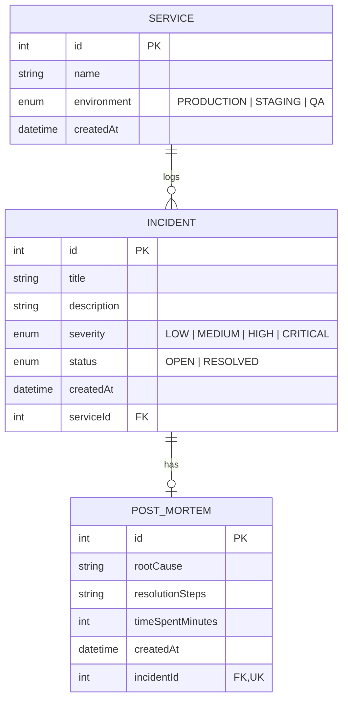

# DevLog: Time-Budgeted Incident & Post-Mortem Logger
## Academic Project Report & Technical Specification

**Course/Level**: Second-Year Computer Science & Engineering Mini-Project  
**Domain**: Full-Stack Web Development, Distributed Systems Operations, & Advanced Database Management  
**Repository**: [https://github.com/afrahghazi14-web/Devlog.git](https://github.com/afrahghazi14-web/Devlog.git)  

---

## 1. Abstract & Problem Statement

Modern software engineering teams operating microservice architectures face frequent operational disruptions ranging from transient network latency to severe database connection pool exhaustion. Resolving production incidents under pressure often leads to two systemic problems:
1. **Unmeasured Resolution Investment**: Teams lack visibility into how much engineering time is spent resolving recurring outages on specific services (Mean Time to Resolution / MTTR).
2. **Lost Institutional Knowledge**: Root cause analyses and remediation steps are frequently discussed in ephemeral chat channels and lost, causing teams to repeatedly diagnose the same recurring defects.

**DevLog** is a lightweight, high-performance web application designed to solve these challenges. Engineering teams register services, log incidents in real time, record exact resolution time budgets, and capture comprehensive post-mortems (root causes and remediation steps) in an atomic database transaction.

---

## 2. System Architecture & Layered Design

DevLog adheres to a strict **4-layer architectural separation of concerns**, completely isolating database logic, business rules, HTTP handling, and network routing:

```
[ HTTP Client (Browser / Fetch) ]
               │
               ▼
   [ 1. Routes Layer ]  (/api/v1/*.routes.js)
               │ Maps HTTP method + URL to controller
               ▼
[ 2. Controllers Layer ] (*.controller.js)
               │ Extracts request body/params, sets status codes, formats JSON
               ▼
  [ 3. Services Layer ]  (*.service.js)
               │ Business validation, transaction orchestration, domain rules
               ▼
[ 4. Repositories Layer ] (*.repository.js)
               │ The ONLY layer that imports Prisma and interacts with PostgreSQL
               ▼
   [ PostgreSQL Database ] (Devlog)
```

### Architectural Responsibilities:
- **Routes Layer** ([backend/src/routes/](backend/src/routes/)): Defines endpoint paths, attaches middleware, and maps endpoints to controller functions.
- **Controllers Layer** ([backend/src/controllers/](backend/src/controllers/)): Extracts payload parameters (`req.body`, `req.params`, `req.query`), delegates execution to the service layer, and issues HTTP status codes (`200 OK`, `201 Created`, `400 Bad Request`, `404 Not Found`, `409 Conflict`). Controllers contain zero database queries.
- **Services Layer** ([backend/src/services/](backend/src/services/)): Implements domain invariants (e.g. verifying referenced services exist before logging incidents; ensuring already resolved incidents cannot be re-resolved).
- **Repositories Layer** ([backend/src/repositories/](backend/src/repositories/)): Houses all database interactions, Prisma queries, and raw SQL. Isolates database drivers from upper layers.

---

## 3. Database Design & Relational Modeling

DevLog uses PostgreSQL modeled in **Third Normal Form (3NF)** with explicit foreign key constraints and cascade rules.

### Entity-Relationship Diagram (ERD)



### Relational Schema & Constraints:
1. **Service Entity**:
   - `id`: Auto-incrementing integer primary key (`SERIAL`).
   - `name`: Service identifier (e.g., `Billing Engine`).
   - `environment`: PostgreSQL enum (`PRODUCTION`, `STAGING`, `QA`).
   - **Composite Unique Constraint**: `@@unique([name, environment])` prevents duplicate service registrations within the same environment while allowing the same service name in different stages.
2. **Incident Entity**:
   - `serviceId`: Foreign key referencing `Service(id)` with `ON DELETE RESTRICT ON UPDATE CASCADE`.
   - `severity`: PostgreSQL enum (`LOW`, `MEDIUM`, `HIGH`, `CRITICAL`).
   - `status`: PostgreSQL enum (`OPEN`, `RESOLVED`, defaulting to `OPEN`).
   - `createdAt`: Timestamp defaulting to `CURRENT_TIMESTAMP`.
3. **PostMortem Entity**:
   - `incidentId`: Unique foreign key (`@unique`) referencing `Incident(id)`. This enforces a strict **1-to-0..1** relationship where each incident can have at most one post-mortem.
   - `timeSpentMinutes`: Integer measuring resolution investment.

---

## 4. Concurrency Control & ACID Transactions

### The Dual-Resolve Race Condition
In collaborative operations environments, two on-call engineers (Alice and Bob) may view the same open incident and click "Resolve" at the exact same moment.

### The Naive Flaw (Read-Then-Write Check):
```text
Alice: Reads status -> "OPEN"
Bob:   Reads status -> "OPEN"
Alice: Updates status to "RESOLVED" and inserts PostMortem
Bob:   Updates status to "RESOLVED" and inserts duplicate PostMortem (Database Corrupted)
```

### The DevLog Atomic Solution:
DevLog wraps the resolve workflow in a single database transaction (`prisma.$transaction`) utilizing an atomic condition update:

```javascript
// backend/src/repositories/incident.repository.js
export async function executeResolveTransaction(incidentId, { rootCause, resolutionSteps, timeSpentMinutes }) {
  return prisma.$transaction(async (tx) => {
    // 1. Verify existence
    const existing = await tx.incident.findUnique({ where: { id: incidentId } });
    if (!existing) return { success: false, notFound: true };

    // 2. Atomic status guard using row-level locking
    const updateResult = await tx.incident.updateMany({
      where: {
        id: incidentId,
        status: "OPEN", // Crucial atomic condition
      },
      data: {
        status: "RESOLVED",
      },
    });

    if (updateResult.count === 0) {
      // Race condition caught: another transaction resolved the incident first
      return { success: false, alreadyResolved: true };
    }

    // 3. Insert PostMortem in the same transaction
    const postMortem = await tx.postMortem.create({
      data: {
        incidentId,
        rootCause,
        resolutionSteps,
        timeSpentMinutes,
      },
    });

    return { success: true, incident: { ...existing, status: "RESOLVED", postMortem } };
  });
}
```

### Concurrency Mechanics Under PostgreSQL Read Committed:
1. When Alice's transaction executes `updateMany`, PostgreSQL places an **exclusive row-level write lock** on the row.
2. Bob's transaction attempts to update the same row and blocks.
3. Alice's transaction commits: `status` becomes `'RESOLVED'` and the lock is released.
4. Bob's transaction resumes. Under **Read Committed** semantics, PostgreSQL re-evaluates the `WHERE` clause (`id = :id AND status = 'OPEN'`) against the newly committed tuple version.
5. The condition evaluates to `FALSE`. Bob's `updateMany` updates **0 rows** (`count: 0`).
6. DevLog catches `count === 0`, rolls back Bob's transaction, and returns `HTTP 409 Conflict: {"error": {"message": "Incident ... is already resolved."}}`.

---

## 5. Performance Engineering & Advanced SQL

### 5.1 Partial B-Tree Indexes
In production incident management, **~95% of incidents are resolved over time**, while the dashboard primarily queries the **~5% of incidents that remain open**.

We added a **partial index** in migration `20261024054943_add_partial_open_incident_index`:
```sql
CREATE INDEX "Incident_open_createdAt_idx" ON "Incident" ("createdAt" DESC)
WHERE status = 'OPEN';
```

#### Empirical Benchmark (20,000 Incidents):
- **Full Table Sequential Scan**: Reads all 527 disk pages, filters out 18,994 resolved rows, performs in-memory top-N heapsort. Execution Time: **1.513 ms**.
- **Partial Index Scan**: Traverses the pre-sorted B-Tree index directly to the first 10 leaf entries, reading only 10 disk blocks. Execution Time: **0.043 ms** (**35.1x speedup**).
- **Storage Footprint**: The partial index occupies only **40 kB** in RAM/disk compared to **632 kB** for the full compound index (**15.8x reduction**).

### 5.2 CTE and Window Function Analytics
The endpoint `GET /api/v1/stats/services` computes service rankings in a single analytical query:

```sql
WITH service_metrics AS (
  SELECT
    s.id,
    s.name,
    s.environment,
    CAST(COUNT(i.id) AS INTEGER) AS "incidentCount",
    CAST(COUNT(CASE WHEN i.status = 'RESOLVED' THEN 1 END) AS INTEGER) AS "resolvedCount",
    CAST(COALESCE(SUM(pm."timeSpentMinutes"), 0) AS INTEGER) AS "totalMinutesSpent",
    ROUND(COALESCE(AVG(CASE WHEN i.status = 'RESOLVED' THEN pm."timeSpentMinutes" END), 0)::NUMERIC, 1)::FLOAT AS "avgMinutesPerResolved"
  FROM "Service" s
  LEFT JOIN "Incident" i ON s.id = i."serviceId"
  LEFT JOIN "PostMortem" pm ON i.id = pm."incidentId"
  GROUP BY s.id, s.name, s.environment
)
SELECT
  id, name, environment,
  "incidentCount", "resolvedCount", "totalMinutesSpent", "avgMinutesPerResolved",
  RANK() OVER (ORDER BY "totalMinutesSpent" DESC)::INTEGER AS rank
FROM service_metrics
ORDER BY rank ASC, name ASC;
```

#### Technical Highlights:
- **Common Table Expression (CTE)**: Encapsulates relational aggregations cleanly.
- **Window Function (`RANK() OVER`)**: Ranks services by time spent directly in the database engine without costly subqueries or application-level sorting loops.
- **BigInt Casting**: Aggregate counts are explicitly cast to 32-bit `INTEGER` to prevent Node.js `BigInt` serialization crashes.

---

## 6. Frontend Architecture & User Experience

DevLog's frontend is built with **React 19**, **Vite**, and **Tailwind CSS**, designed as a modern dark-mode operations console.

### Key Frontend Components:
1. **TanStack Query (React Query v5)**:
   - Manages asynchronous server state caching.
   - All mutations ([useCreateIncident](frontend/src/hooks/useCreateIncident.js), [useResolveIncident](frontend/src/hooks/useResolveIncident.js), [useCreateService](frontend/src/hooks/useCreateService.js)) invoke `queryClient.invalidateQueries()`, updating table rows, summary cards, and service analytics instantly with zero page reloads.
   - Configured with `placeholderData: keepPreviousData` for seamless pagination transitions without layout shifts.
   - Automatic 30-second polling and window focus refetching.
2. **React Hook Form**:
   - Manages modal forms with synchronous client-side validation for required fields, min/max text lengths, and numeric ranges.
   - Renders error messages beneath invalid inputs while trapping focus inside modals.
3. **Accessible Modal Primitive** ([Modal.jsx](frontend/src/components/Modal.jsx)):
   - Overlay backdrop with blur.
   - Keyboard listener for `Escape` key dismissal.
   - Click-outside backdrop dismissal.
   - Focus management: shifts focus into the modal container upon opening and restores focus to the previously active element upon closing.
4. **React Router & Layout**:
   - Single persistent layout ([AppLayout.jsx](frontend/src/layouts/AppLayout.jsx)) containing a top navigation bar, active link indicators, and nested `<Outlet />`.
   - Wrapped in a class-based [ErrorBoundary.jsx](frontend/src/components/ErrorBoundary.jsx) to prevent client crashes and provide a recovery UI.

---

## 7. Quality Assurance, Security, & Testing

1. **Automated Integration Tests**:
   - Implemented in [backend/tests/api.test.js](backend/tests/api.test.js) using Node.js's native test runner (`node:test`, `assert/strict`) and native `fetch`.
   - 13 comprehensive tests covering: health checks, service creation/listing, duplicate conflicts, incident CRUD, validation errors, atomic resolution, race conditions, pagination envelopes, and CTE window analytics.
2. **Security & Hardening**:
   - **Helmet**: Sets HTTP security headers (`Content-Security-Policy`, `X-Content-Type-Options: nosniff`, `X-Frame-Options: SAMEORIGIN`).
   - **Rate Limiting**: Clamps client IPs to 300 requests per 15-minute window via `express-rate-limit`.
   - **Payload Clamping**: Body parser caps requests at `100kb` to prevent memory exhaustion attacks.
   - **CORS Protection**: Restricted to configured frontend origins (`localhost:5173`, `localhost:5174`).
3. **No TypeScript & No MongoDB Compliance**:
   - Verified 100% plain JavaScript codebase across backend and frontend.

---

## 8. Conclusion

DevLog successfully demonstrates how a second-year engineering mini-project can achieve production-grade quality by combining clean architectural layering, rigorous database concurrency control, empirical query optimization, and reactive modern frontend patterns.
